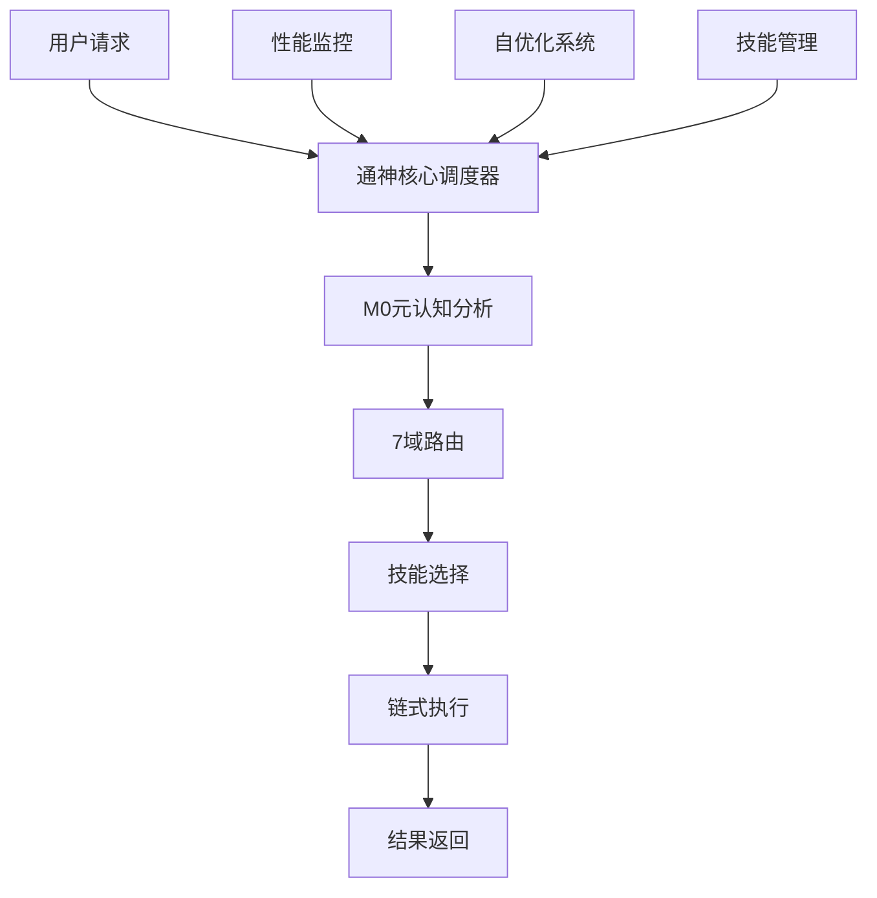

# 🚀 通神认证Agent | Tongshen Auth Agent

<div align="center">

[](https://github.com/your-username/tongshen-auth-agent)
[](https://github.com/your-username/tongshen-auth-agent)
[](https://github.com/your-username/tongshen-auth-agent/issues)
[](https://github.com/your-username/tongshen-auth-agent/blob/main/LICENSE)

[](https://nodejs.org/)
[](https://www.typescriptlang.org/)

</div>

## 📖 项目简介

通神认证Agent是一个融合了**78个专业技能**的AI系统，实现了真正的**自优化进化**能力。它深度集成了通神兵器库的所有功能，能够处理从交易分析到内容创作的各种复杂任务。

### ✨ 核心特性

- 🔥 **78个专业技能** - 涵盖交易、内容、研究、开发等多个领域
- 🧠 **M0元认知** - 自我反思、策略规划、任务分解
- 🎯 **7域路由** - 自动识别并路由到最适合的技能
- 🔗 **链式执行** - 绕过输出限制，分步完成任务
- 🔄 **自优化进化** - 持续学习和改进系统性能
- 🌐 **Web API接口** - 完整的RESTful API支持

## 🎯 技能分类

| 分类 | 数量 | 功能描述 |
|------|------|----------|
| 🎯 通神核心 | 7 | 全域调度、反截断、团队调度、自进化等 |
| 💰 交易/量化 | 7 | 金价分析、VolBreak回测、自动交易、BTC/ETH检测等 |
| 📝 内容/公众号 | 12 | 公众号发布、帝意日报、视频生成、财经文章等 |
| 🔍 研究/数据 | 5 | 深度调研、宏观数据、AI搜索、多引擎搜索等 |
| 🛠️ 开发/部署 | 6 | 网站部署、GitHub Pages、Vercel部署等 |
| 🛠️ 工具类 | 15 | 文件转换、图片生成、安全审计、笔记管理等 |
| 🔧 其他 | 18 | 浏览器自动化、视频图像、GitHub工具、AI/Coze等 |

## 🚀 快速开始

### 环境要求

- Node.js >= 16.0.0
- npm >= 8.0.0
- Windows 10/11 或 Linux/macOS

### 安装部署

#### 方法一：自动部署（推荐）

```bash
# 1. 克隆仓库
git clone https://github.com/your-username/tongshen-auth-agent.git
cd tongshen-auth-agent

# 2. 运行部署脚本
node deploy-to-claude.js
```

#### 方法二：手动部署

```bash
# 1. 安装依赖
npm install

# 2. 配置环境变量
cp .env.example .env
# 编辑.env文件，填入必要的配置

# 3. 启动服务
node core-scheduler.js
```

### 验证安装

```bash
# 运行测试脚本
node test.js

# 检查服务状态
curl http://localhost:3000/status

# 获取技能列表
curl http://localhost:3000/skills
```

## 💻 使用方法

### 1. 直接触发

在对话中直接说出技能触发词：

```bash
"分析一下黄金XAUUSD"        → 触发 trading-analysis
"执行帝意日报"              → 触发 diyi-daily
"发公众号"                  → 触发 wechat-publisher
"深度调研XX"                → 触发 deep-research
"回测VolBreak策略"          → 触发 volbreak-backtest
```

### 2. 组合使用

系统会自动选择最适合的技能组合：

```bash
"分析市场并发布报告"        → trading-analysis + wechat-publisher
"创建一个完整的营销方案"    → 自动分解为多个子任务
```

### 3. API调用

```bash
# 获取技能列表
curl http://localhost:3000/skills

# 查找技能
curl "http://localhost:3000/skills/find?trigger=黄金"

# 执行技能
curl -X POST http://localhost:3000/execute \
  -H "Content-Type: application/json" \
  -d '{"skill": "trading-analysis", "context": {"symbol": "XAUUSD"}}'

# 获取统计信息
curl http://localhost:3000/stats
```

## 📁 项目结构

```
tongshen-auth-agent/
├── 📄 README.md               # 项目说明
├── 📄 SKILL.md               # 技能索引
├── 📄 LICENSE                # 开源协议
├── 📄 .gitignore             # Git忽略规则
├── 📄 DEPLOYMENT_CHECKLIST.md # 部署检查清单
├── 📄 claude-integrated.md   # Claude集成设计
├── 📄 create-github-repo.js  # 仓库创建脚本
├── 📄 deploy-to-claude.js    # 部署脚本
├── 📄 test.js                # 测试脚本
├── 🔧 auth-agent-core.js     # 认证Agent核心
├── 🔧 core-scheduler.js      # 核心调度器
├── 🔧 server.js              # Web服务器
├── ⚙️ configs/               # 配置文件
│   ├── tongshen-integration.json  # 集成配置
│   └── mcp-integrated.json        # MCP配置
├── 📚 skills/                # 技能目录
│   └── index.json            # 技能索引
├── 📝 logs/                  # 日志文件
│   └── tongshen.log         # 主日志
└── 🚀 start.sh              # 启动脚本
```

## 🛠️ 技术架构

### 系统架构



### 核心模块

1. **认证Agent核心** (auth-agent-core.js)
   - 技能管理系统
   - 性能监控
   - 自优化进化

2. **核心调度器** (core-scheduler.js)
   - 元认知模块
   - 智能路由
   - 任务链管理

3. **Web服务** (server.js)
   - RESTful API
   - 技能管理界面
   - 实时监控

## 🔧 配置说明

### 主配置文件 (configs/tongshen-integration.json)

```json
{
  "version": "2.0.0",
  "name": "通神认证Agent",
  "skills": {
    "path": "D:\\WorkBuddy",
    "autoLoad": true,
    "categories": [...]
  },
  "mcp": {
    "enabled": true,
    "servers": [...]
  },
  "evolution": {
    "enabled": true,
    "interval": 60000
  }
}
```

### 环境变量 (.env)

```env
TONGSHEN_AGENT_ENABLED=true
TONGSHEN_AGENT_PATH=C:\Users\Administrator\Desktop\通神兵器库
TONGSHEN_SKILLS_PATH=D:\WorkBuddy
TONGSHEN_EVOLUTION_ENABLED=true
TONGSHEN_EVOLUTION_INTERVAL=60000
MCP_FIRECRAWL_KEY=fc-7f6c51167e4d4c4abe925b8d179ae30d
MCP_GITHUB_TOKEN=ghp_YOUR_TOKEN_PLACEHOLDER
```

## 📊 性能特性

### 自优化机制

- **性能监控**: 实时跟踪每个技能的执行效果
- **智能优化**: 基于使用模式自动调整技能策略
- **自动升级**: 技能版本自动更新
- **进化周期**: 每分钟自动优化系统

### 目标指标

- 技能加载时间 < 5秒
- 任务响应时间 < 2秒
- 成功率 > 90%
- 内存使用 < 500MB

## 🐛 故障排除

### 常见问题

#### 技能加载失败
1. 检查技能路径配置
2. 验证SKILL.md文件格式
3. 查看日志文件

#### MCP连接失败
1. 检查网络连接
2. 验证API密钥
3. 重启MCP服务

#### 任务执行超时
1. 检查资源使用
2. 增加超时时间
3. 优化技能逻辑

### 日志查看

```bash
# 查看主日志
tail -f logs/tongshen.log

# 查看错误日志
tail -f logs/error.log

# 查看访问日志
tail -f logs/access.log
```

## 🔒 安全说明

- API凭证使用环境变量管理
- 定期轮换访问令牌
- 文件权限严格控制
- 网络传输加密（HTTPS）

## 📈 监控与维护

### 性能监控

- 实时统计API: `GET /stats`
- 导出配置: `GET /export`
- 手动优化: `POST /optimize`

### 备份策略

- 自动备份配置文件
- 定期备份技能数据
- 保留操作日志

## 🤝 贡献指南

我们欢迎各种形式的贡献！

### 贡献方式

1. **报告Bug**: 使用GitHub Issues
2. **建议功能**: 使用GitHub Discussions
3. **提交代码**: Fork并提交Pull Request
4. **贡献技能**: 创建新的技能目录

### 开发规范

- 遵循ESLint规范
- 编写测试用例
- 提交信息清晰
- 保持代码风格一致

### 技能开发

1. 创建技能目录
2. 编写SKILL.md文件
3. 实现execute函数
4. 添加测试用例

## 📄 开源协议

本项目采用 MIT 协议开源，详见 [LICENSE](LICENSE) 文件。

## 📞 支持

- 📧 Email: [tongshen@agent.com](mailto:tongshen@agent.com)
- 💬 Discussions: [GitHub Discussions](https://github.com/your-username/tongshen-auth-agent/discussions)
- 🐛 Issues: [GitHub Issues](https://github.com/your-username/tongshen-auth-agent/issues)
- 📖 文档: [Wiki](https://github.com/your-username/tongshen-auth-agent/wiki)

## 🙏 致谢

感谢所有贡献者的努力！特别感谢：
- 通神兵器库的原作者
- Claude AI团队
- 开源社区的贡献者

## 📝 更新日志

### v2.0.0 (2024-01-01)
- ✨ 首次发布
- 🎯 集成78个技能
- 🧠 实现自优化进化
- 🌐 完整API接口

---

<div align="center">

**让AI系统不断进化** 🔄

[⭐ Star](https://github.com/your-username/tongshen-auth-agent) · [🐛 报告Bug](https://github.com/your-username/tongshen-auth-agent/issues) · [💡 提建议](https://github.com/your-username/tongshen-auth-agent/discussions)

</div>